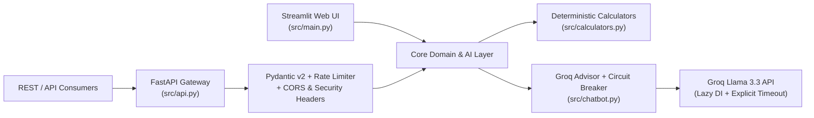

# Finana AI Financial Advisor

[](https://github.com/subki72/finana-ai-advisor/actions/workflows/ci.yml)
[](LICENSE)
[](pyproject.toml)

Production-ready personal finance platform combining **deterministic financial calculators** (50/30/20 budgeting, emergency fund sizing, and KPR/mortgage Debt Service Ratio assessment) with a **Groq Llama 3.3 conversational advisor**, served through both a **FastAPI microservice gateway** and a **Streamlit web interface**.

---

## Architecture Overview



### Key Capabilities

- **Deterministic Financial Calculators (`src/calculators.py`)**: Pure, dependency-free domain logic for 50/30/20 monthly budget allocation, risk-adjusted emergency fund targets (3-12 months), and mortgage affordability / Debt Service Ratio (DSR) analysis.
- **FastAPI Microservice (`src/api.py`)**: Versioned REST API with `GET /health` liveness/readiness probe, Pydantic v2 strict contracts (`extra="forbid"`), sliding-window rate limiter (`429 Retry-After`), explicit CORS allowlists, security headers, and a centralized `500` error boundary.
- **Resilient LLM Integration (`src/chatbot.py`)**: Lazy Groq client factory (`get_groq_client`) with explicit network timeout, thread-safe `CircuitBreaker`, PII-free metadata logging (`message_chars`, `reply_chars`), and sanitized external fallback messages.
- **Interactive Streamlit UI (`src/main.py`)**: Responsive chat workspace with quick prompts, session reset, and an integrated 50/30/20 sidebar calculator.

---

## Quickstart

### 1. Local Setup with Makefile

```bash
git clone https://github.com/subki72/finana-ai-advisor.git
cd finana-ai-advisor

python -m venv .venv
# Windows: .\.venv\Scripts\activate
# Linux/macOS: source .venv/bin/activate

make install
cp .env.example .env
```

Add your Groq API key to `.env` if you want live LLM replies (calculators and all automated tests work offline without an API key).

### 2. Run Verification Gates

```bash
make lint   # Ruff check, Ruff format check, and Flake8
make test   # Offline Pytest suite with >= 75% coverage gate
```

### 3. Run Services Locally

```bash
# Start FastAPI microservice on http://127.0.0.1:8000
make run-api

# Or start Streamlit web UI on http://127.0.0.1:8501
make run-ui
```

### 4. Run with Docker Compose

```bash
docker compose up --build
```

- FastAPI Gateway & OpenAPI Docs: `http://localhost:8000/docs`
- FastAPI Health Probe: `http://localhost:8000/health`
- Streamlit UI: `http://localhost:8501`

---

## API Endpoints

| Method | Path | Description | Rate Limited |
|---|---|---|---|
| `GET` | `/health` | Service liveness and `llm_configured` readiness status | No |
| `POST` | `/api/v1/budget` | Deterministic 50/30/20 monthly budget allocation | No |
| `POST` | `/api/v1/emergency-fund` | Target emergency reserve (3-12 months) by stability and dependents | No |
| `POST` | `/api/v1/mortgage` | Annuity mortgage installment and combined DSR affordability verdict | No |
| `POST` | `/api/v1/chat` | Conversational Groq Llama 3.3 advisor with bounded history | Yes (`429`) |

---

## Environment Configuration

See [`.env.example`](.env.example) for all supported runtime settings:

| Variable | Default | Purpose |
|---|---|---|
| `GROQ_API_KEY` | `""` | Groq API credential (evaluated lazily on live `/api/v1/chat` calls) |
| `GROQ_MODEL` | `llama-3.3-70b-versatile` | Target Groq chat completion model |
| `REQUEST_TIMEOUT_SECONDS` | `30.0` | Explicit upstream HTTP client timeout (0-300 seconds) |
| `ALLOWED_ORIGINS` | `http://localhost:8501,...` | Comma-separated CORS allowlist |
| `RATE_LIMIT_PER_MINUTE` | `30` | Sliding-window per-IP request cap for `/api/v1/chat` |
| `CIRCUIT_BREAKER_THRESHOLD` | `3` | Consecutive upstream failures before opening circuit |
| `CIRCUIT_BREAKER_COOLDOWN_SECONDS` | `30.0` | Cooldown window before half-open recovery probe |
| `LOG_LEVEL` | `INFO` | Structured JSON log threshold (`DEBUG`..`CRITICAL`) |

---

## Project Structure

```text
finana-ai-advisor/
├── .github/
│   ├── workflows/ci.yml        # Ruff, Flake8, Pytest >=75%, Semgrep, Docker, Trivy, Tag Release
│   └── dependabot.yml          # Weekly pip & GitHub Actions dependency updates
├── docs/
│   └── RUNBOOK.md              # Incident triage, health verification, and rollback procedures
├── src/
│   ├── api.py                  # FastAPI gateway, middleware, rate limiter, global error boundary
│   ├── calculators.py          # Pure 50/30/20, emergency fund, and mortgage/DSR calculators
│   ├── chatbot.py              # Lazy Groq DI client, CircuitBreaker, PII-safe logging
│   ├── config.py               # Validated Settings dataclass and JSON logging setup
│   ├── main.py                 # Streamlit UI entrypoint
│   └── schemas.py              # Pydantic v2 request/response contracts
├── tests/                      # 5 offline Pytest unit and FastAPI integration test modules
├── Dockerfile                  # Multi-stage non-root (UID 10001) container with HEALTHCHECK
├── docker-compose.yml          # Multi-service API + Streamlit orchestration
├── Makefile                    # One-command install, lint, format, test, and run targets
├── pyproject.toml              # Project metadata, Ruff, and Pytest configuration
├── requirements.txt            # Exact pinned runtime/test dependencies
├── requirements-lock.txt       # Full cross-platform uv-compiled lockfile
└── uv.lock                     # Universal uv lockfile
```

---

## Security & Governance

- Zero secrets in source control (`.env*` excluded in `.gitignore`, checked in CI).
- Zero raw financial narratives or replies logged to stdout.
- See [`SECURITY.md`](SECURITY.md), [`CONTRIBUTING.md`](CONTRIBUTING.md), [`CHANGELOG.md`](CHANGELOG.md), and [`LICENSE`](LICENSE).
